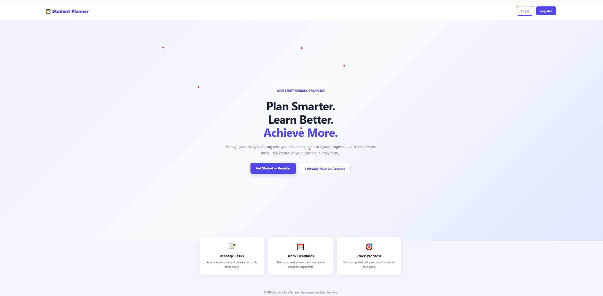
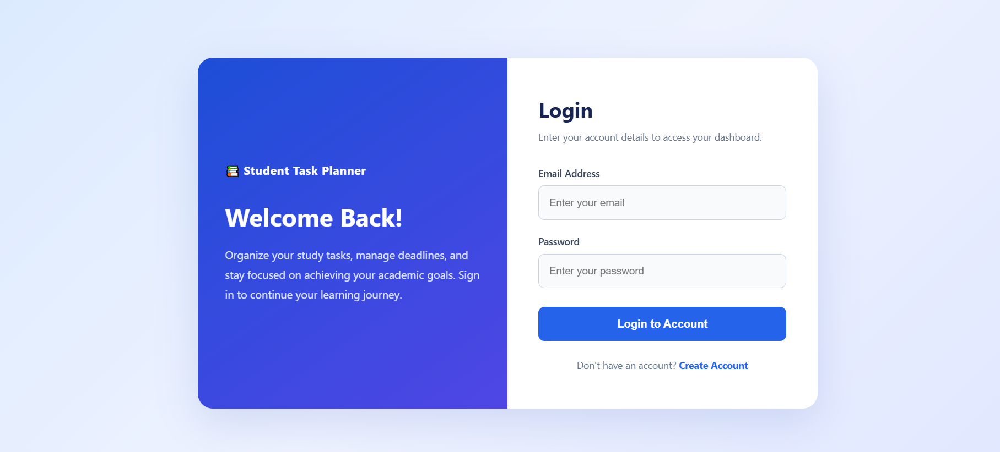
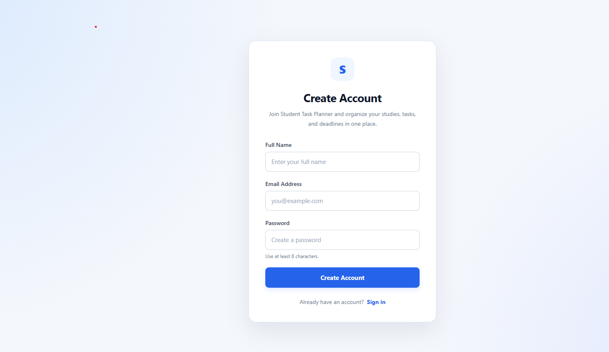
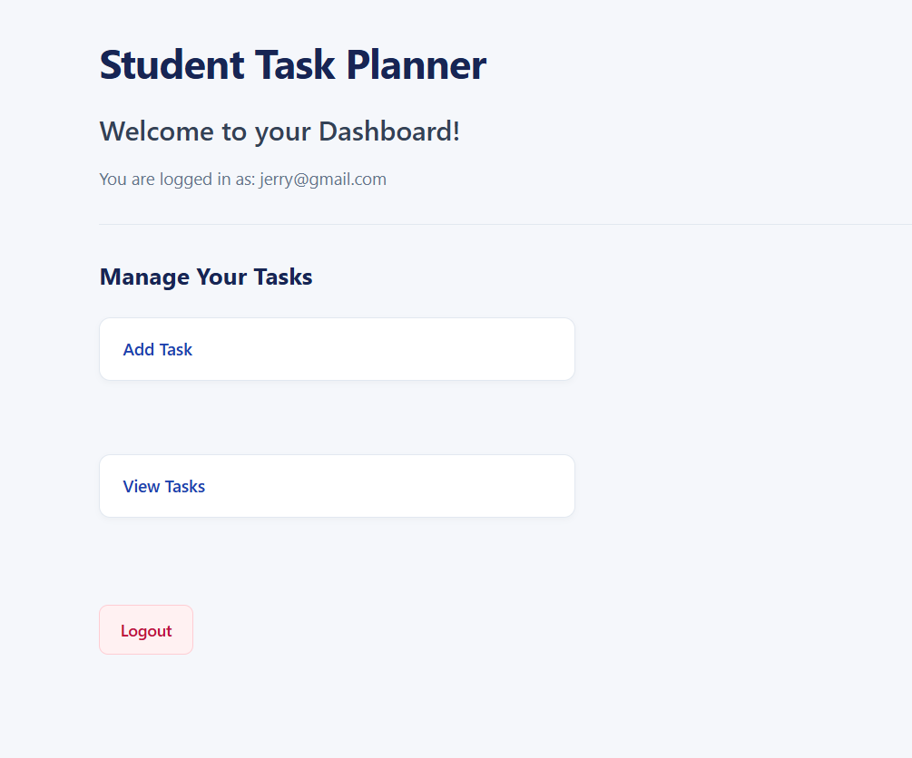
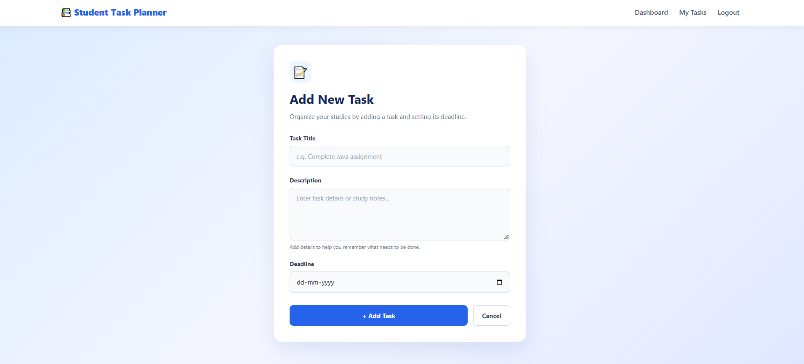
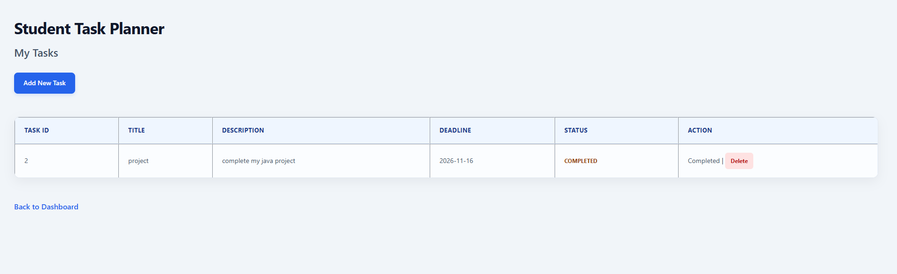

# Student Task Planner

Student Task Planner is a web-based application developed to help students organize their academic tasks, manage deadlines, and track their task completion status.

The application allows users to register, log in, add tasks, view their personal tasks, mark tasks as completed, and delete tasks.

# Features

- User Registration
- User Login and Logout
- Add New Tasks
- View All Personal Tasks
- Manage Task Deadlines
- Mark Tasks as Completed
- Delete Tasks
- User-specific Task Management
- Session-based User Authentication

# Technologies Used

- Java
- Servlet API
- JSP (JavaServer Pages)
- JDBC API
- MySQL
- HTML5
- CSS3
- Apache Tomcat
- Eclipse IDE

# Project Structure

StudentTaskPlanner/
│
├── src/
│   └── com/studentplanner/
│       ├── connection/
│       │   └── DBConnection.java
│       │
│       ├── dao/
│       │   ├── UserDAO.java
│       │   └── TaskDAO.java
│       │
│       ├── dto/
│       │   ├── UserDTO.java
│       │   └── TaskDTO.java
│       │
│       └── servlet/
│           ├── RegisterServlet.java
│           ├── LoginServlet.java
│           ├── LogoutServlet.java
│           ├── AddTaskServlet.java
│           ├── ViewTasksServlet.java
│           ├── CompleteTaskServlet.java
│           └── DeleteTaskServlet.java
│
├── WebContent/
│   ├── css/
│   │   └── style.css
│   ├── index.jsp
│   ├── register.jsp
│   ├── login.jsp
│   ├── dashboard.jsp
│   ├── addTask.jsp
│   └── viewTasks.jsp
│
└── README.md

# Database Configuration

1. Create a MySQL database named `student_planner_db`.
2. Create the required `users` and `tasks` tables.
3. Configure your MySQL username and password in `DBConnection.java`.
4. Make sure the MySQL JDBC driver is added to your project.

# How to Run

1. Clone or download this repository.
2. Import the project into Eclipse IDE.
3. Configure Apache Tomcat Server.
4. Create the MySQL database and required tables.
5. Update the database credentials in `DBConnection.java`.
6. Add the MySQL Connector/J library if it is not already included.
7. Run the project on Apache Tomcat Server.
8. Open the application in your browser.

# Website Preview

# 1. Index Page

# 2. Login Page

# 3. Register Page

# 4. Dashboard Page

# 5. Add Task Page

# 6. View Tasks Page

# Future Enhancements

- Task priority management
- Search and filter tasks
- Improved dashboard with task statistics
- Email reminders for upcoming deadlines

# Developed By

Developed as a Java Web Development project using Java, Servlet API, JSP, JDBC, and MySQL.
